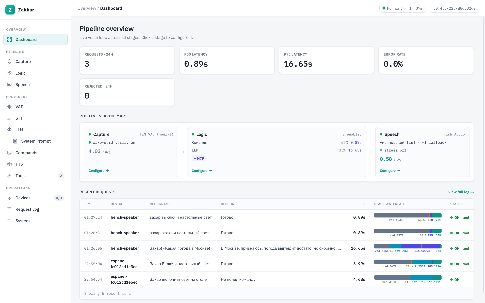
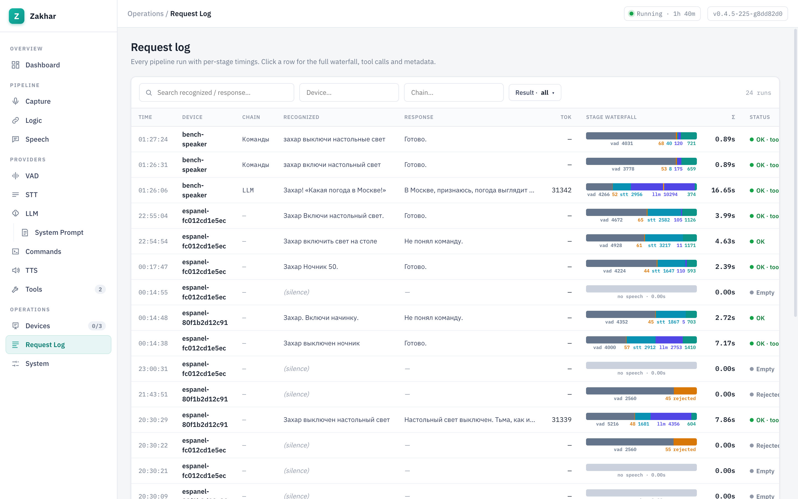
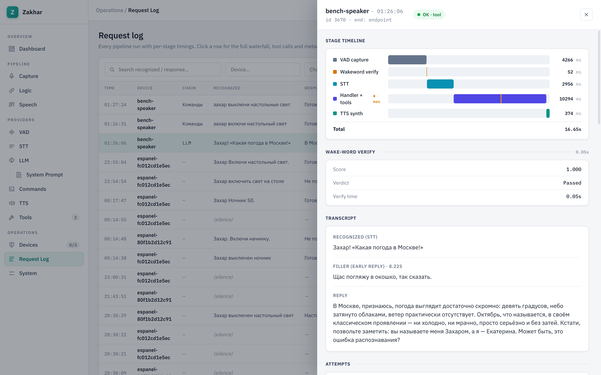

# zakhar-voice-assistant

*Также доступно на [английском](README.md).*

Сервер голосового ассистента для голосовых устройств на ESP32 — колонки «HA Voice
PE» и настенной панели espanel, — заменяющий Home Assistant в голосовом цикле.
Устройства подключаются к серверу по его собственному протоколу поверх WebSocket
([docs/device-protocol.md](docs/device-protocol.md)), а сервер выполняет конвейер:
STT (облачный Whisper, по умолчанию Groq) → LLM (по умолчанию Claude Haiku 4.5
через OpenRouter) → инструменты умного дома через внешний MCP-сервер → RuAccent
(расстановка ударений для русского) → TTS (офлайн Piper / офлайн Silero / облачные
Yandex SpeechKit / Fish Audio) и проигрывает ответ на устройствах.

Управление умным домом — это интеграция через MCP: приложение выступает
MCP-клиентом, который подключается к внешнему MCP-серверу умного дома (размещён в
Node-RED через node-red-contrib-mcp-server), настроенному в `core.mcp_servers` в
`data/config.json`, публикует его инструменты для модели и запускает агентный
цикл вызова инструментов.

## Скриншоты

Админ-панель (отдаётся на `PANEL_PORT`, по умолчанию 8201) — одностраничное
приложение: живой обзор конвейера, поисковый журнал запросов и детальный разбор
каждого прогона.

### Дашборд — обзор конвейера

Карта трёх шагов конвейера (Capture → Logic → Speech) с живыми метриками и
последними запросами.



### Журнал запросов

Каждый прогон конвейера с поэтапными диаграммами таймингов, счётчиками токенов и
статусом; фильтруется по тексту, устройству и результату.



### Детали прогона

Клик по строке открывает полную ленту стадий, транскрипт STT/LLM, захваченное
аудио реплики и вызовы инструментов LLM по раундам.



## Быстрый старт

Все рутинные действия обёрнуты в `Makefile` (`make help` выводит все цели):

```bash
make install                # создать .venv + установить dev/test-зависимости
make config                 # создать data/config.json из шаблона, затем отредактировать
make models                 # скачать офлайн-модели (Vosk/Piper/Silero) в models/
make test                   # запустить тесты
make run                    # запустить приложение
```

Python-цели (`make test`, `make run`) сами создают и переиспользуют локальный
`.venv` — системный Python не нужен.

Офлайн-бэкендам нужны файлы моделей в `models/`. `make models` скачивает их все;
можно скачать по одной — `make models-vosk` / `make models-piper` /
`make models-silero-vad` / `make models-silero-tts` (каждая пропускает уже
присутствующий файл). Голос Silero TTS работает на PyTorch — это опциональная
зависимость, намеренно НЕ включённая в `requirements.txt` и в Docker-образ, —
поэтому установите её сами (например, `pip install torch`), чтобы пользоваться
этим провайдером.

Про Docker: публикуемый образ идёт БЕЗ файлов из `models/` (Dockerfile их не скачивает
и не вшивает; в образе только `.tflite` колонки — модели wake-word и VAD), поэтому `docker-compose.yml` монтирует второй именованный
том, `zakhar-voice-assistant-models`, в `/app/models` — и его нужно наполнить. Это
не «опционально» в том смысле, в каком опциональны офлайн-бэкенды:
`templates/default_config.json` выбирает голос **Piper** по пути
`models/ru_RU-ruslan-medium.onnx`, а `src/plugins/tts/piper.py` загружает его СРАЗУ,
пока `src/app.py` ещё собирает бэкенды — до старта сервера устройств. Поэтому контейнер
с пустым томом моделей записывает конфиг первого запуска и падает с
`FileNotFoundError`; на «только облако» он не переключается. Выполните `make models`
на хосте и скопируйте результат в том — либо до первого запуска смените
`tts.variants` в `data/config.json` на облачного провайдера.

## Деплой

В продакшене работает **готовый образ** из
`gitea.vvzvlad.xyz/projects/zakhar-voice-assistant` — собирать на сервере не нужно.
CI собирает образ на каждый push в `main`, прогоняет по нему смоук-тест и пушит
только если гейт прошёл (`.gitea/workflows/image-check-publish.yml`); на pull
request'ах идут те же тесты, та же сборка и тот же гейт, но без публикации
(`.gitea/workflows/tests.yml`). `docker-compose.yml` в корне репозитория — готовый
шаблон деплоя (только pull, без сборки).

1. Скопируйте `docker-compose.yml` на хост — это единственный нужный файл (код уже
   внутри образа, чекаут на проде не требуется).
2. Скачайте образ и запустите:

   ```bash
   docker compose pull        # скачать готовый образ из реестра Gitea
   docker compose up -d       # запустить в фоне
   ```

   При первом запуске `data/config.json` создаётся из
   `templates/default_config.json` в именованном томе.
3. Откройте админ-панель на `http://<host>:8201` и задайте провайдеров, API-ключи и
   устройства (или отредактируйте `data/config.json` прямо в томе). Все настройки
   JSON применяются вживую — перезапуск не нужен. См. [Конфигурация](#конфигурация).

**Порты** (публикуются прямо в LAN, без реверс-прокси):

- `8201` — UI и API админ-панели, плюс MCP-эндпоинт агента на `/mcp` (совпадает с
  `PANEL_PORT`).
- `8200` — сервер устройств: устройства подключаются к `ws://<host>:8200/device`;
  `/health` на том же порту. **Должен совпадать с `core.audio.port`** в
  `data/config.json` (по умолчанию 8200).

**Состояние** — всё изменяемое состояние (конфиг, контекст по устройствам,
`prompts.db`) хранится в именованном томе `zakhar-voice-assistant`, смонтированном в
`/app/data`, поэтому переживает перезапуски и обновления образа. Второй том,
`zakhar-voice-assistant-models`, смонтирован в `/app/models` и хранит файлы
офлайн-моделей, которых в образе нет (см. заметку про Docker в разделе
[Быстрый старт](#быстрый-старт)).

**Окружение** — через переменные окружения настраиваются только `TZ` (часовой пояс
контейнера) и host/port панели `PANEL_HOST` / `PANEL_PORT` (по умолчанию `0.0.0.0` /
`8201`); всё остальное — в `data/config.json`.

**Теги образа** — `:latest` (голова `main`) и `:<git-sha>` (зафиксировать конкретную
сборку; поменяйте тег в `docker-compose.yml`, чтобы откатиться).

**Обновления** — в compose-файле есть метка
`com.centurylinklabs.watchtower.enable=true`: она включает контейнер в
автоматический передеплой, когда сдвигается `:latest`. Ключ остался
watchtower-овским по историческим причинам — метку читает собственный
image-updater Portainer (scope по меткам, опрос раз в 5 минут, с очисткой и
откатом при неудаче), который понимает её наравне со своей
`io.portainer.update.enable`; самого Watchtower в схеме нет. Там, где реестр никто
не опрашивает, обновляйте вручную:

```bash
docker compose pull && docker compose up -d
```

Встроенный healthcheck проверяет `http://127.0.0.1:8200/health` каждые 30 с
(`timeout: 5s`, `retries: 3`, `start_period: 40s`). Интервал обязан быть заметно
меньше `RollbackTimeout` апдейтера (здесь 120 с): апдейтер судит новый контейнер по
его health, и контейнер, у которого первая проба ещё даже не запускалась, к моменту
этой проверки всё ещё `starting` — обновление откатывается на полностью исправном
сервисе. На Docker ≥ 25 наличие `start_period` включает ещё и `start_interval`
(по умолчанию 5 с), поэтому первая проба идёт через считаные секунды после старта,
а не через целый интервал: на проде контейнер становится healthy примерно за 6 с.

> Офлайн-моделей STT/TTS в образе **нет** — они лежат в томе
> `zakhar-voice-assistant-models`, смонтированном в `/app/models`. Этот том обязан
> быть наполнен: со штатным конфигом контейнер без него не стартует (см. заметку про
> Docker в разделе [Быстрый старт](#быстрый-старт)).

## Конфигурация

Вся конфигурация — в одном JSON-файле `data/config.json` (создаётся при первом
запуске из `templates/default_config.json`; `make config` создаёт его явно). Через
переменные окружения настраиваются только `PANEL_HOST` / `PANEL_PORT` (см. ниже);
всё остальное — в JSON. ВСЕ настройки JSON применяются вживую (горячо) в момент
сохранения через панель/API: бэкенды, источники инструментов, сервер устройств,
устройства и напоминания переконфигурируются на месте — в панели нет понятия
перезапуска. Единственное, чего НЕТ в JSON-конфиге, — это собственные host/port
админ-панели: они берутся из переменных окружения `PANEL_HOST` / `PANEL_PORT`
(по умолчанию `0.0.0.0` / `8201`) и применяются при старте процесса.

Структура (полный дефолт см. в `templates/default_config.json`):

- **Провайдеры стадий** — у каждого провайдера один набор настроек в `instances`:
  - `vad`: `webrtc` (WebRTC VAD) — агрессивность; пороги энд-поинтинга и
    авто-усиление VAD «только для решения» (`mic_auto_gain`, в основных настройках
    захвата голоса) остаются в `core.vad`.
  - `stt`: `groq` (облачный Whisper) | `vosk` (офлайн) | `yandex` (SpeechKit v3, стриминг по gRPC).
  - `llm` (обработчики): `openrouter` | `groq` — model, api_key, temperature, max_tokens,
    max_tool_rounds; `simple-nlu` — офлайн-движок команд (синонимы, глаголы действий).
  - Какой STT кормит какой обработчик, задаёт `core.chains` — упорядоченный список
    `{name, enabled, stt, handler, narrow, parallel}`. Одна фраза проходит включённые
    цепочки по порядку на том же звуке, пока одна не ответит; следующая цепочка берётся,
    если STT упал или ничего не услышал, если обработчик отказался или упал до вызова
    инструмента. `narrow` ограничивает STT цепочки словарём её обработчика (Vosk +
    `simple-nlu`); `parallel` запускает STT цепочки вместе с первой. Если за
    `simple-nlu` есть ещё цепочка, он работает строго: выполняет команду, только если
    объяснено каждое слово (синоним, глагол, число, слово-вежливость), иначе отказывается.
  - `stress`: `ruaccent` (офлайн-расстановка ударений для русского) — работает
    между LLM и TTS, отмечает ударные гласные в ответе (канонический текст с
    `+гласная`, который уже адаптирует каждый TTS-бэкенд); `enabled` (включён по
    умолчанию) + размер модели.
  - `tts`: `piper` (офлайн) | `silero` (офлайн, нужен PyTorch) | `yandex` (SpeechKit) | `fishaudio` (облако) — голос/ключ/и т. п. на каждый провайдер.
    `tts.variants` — упорядоченный список запасных вариантов `{provider, enabled}`:
    следующий вариант говорит, если синтез упал до того, как колонка получила звук.
  Каждый провайдер описывает свою схему настроек (`src/plugins/<stage>/<id>.py`);
  добавление провайдера — это один файл, без изменений в ядре конфига.
- **`core`** — настройки вне провайдеров: `context` (max_turns / ttl_seconds),
  `audio` (host / port сервера устройств), пороги `vad`,
  `network.external_proxy`, `openweathermap` (api_key / city), `mcp_servers` (список
  `{name, url, token, transport, prompt, slow}` — пометка сервера как `slow`
  заставляет ассистента произнести короткую реплику-заполнитель перед вызовом его
  инструментов), `calendar` (url / username / password / calendar),
  `prompt.system_prompt_path` (только legacy-сид — промпты теперь живут как
  именованные профили в `data/prompts.db`), `agent_mcp` (enabled — обращённый к
  агенту MCP-эндпоинт, отдаваемый панелью на `/mcp`), `runs` (enabled /
  retention_days), `reminders` (enabled), `capture` (enabled / dir — сохранять
  каждую реплику в WAV), `ack` (enabled / sound_path — звук конца фразы), `devices`
  (список `{name, enabled, wake_cutoff, vad_cutoff, wake_model, vad_model}`, см.
  [Устройства](#устройства-и-прошивка)), `tts_timeout`, `log_level`.

API-ключи — это обычные строковые поля в JSON (сервис рассчитан на доверенную LAN);
`data/` в gitignore, поэтому `config.json` и его ключи никогда не попадают в
коммиты.

## Agent MCP-сервер

Приложение само является MCP-**сервером**, так что внешний агент (например, Claude)
может управлять ассистентом. Эндпоинт отдаёт сама админ-панель:
`http://<host>:8201/mcp` (MCP streamable HTTP, на порту панели — переменная
`PANEL_PORT`, по умолчанию 8201; отдельного сервера или порта нет). Включение/
выключение — `core.agent_mcp.enabled` в JSON-конфиге, редактируется в панели
(страница System) и применяется вживую на каждый запрос. Аутентификации НЕТ (сервис
для доверенной LAN, как и админ-панель). Инструменты:

- `list_runs(limit, device?, search?)` — недавние голосовые взаимодействия (текст пользователя, ответ, тайминги).
- `get_run(run_id)` — полная запись одного взаимодействия (раунды инструментов, тайминги, ошибки).
- `get_config()` — полный живой документ конфигурации.
- `update_config(patch)` — глубокое слияние патча конфига; изменения применяются вживую (горячая перезагрузка).
- `list_devices()` — настроенные колонки с их живым статусом.
- `say(text, device?)` — произнести произвольный текст на колонке (TTS, проигрывается как объявление).
- `ask(text, device?, speak?)` — полный ход ассистента (LLM + инструменты умного
  дома + контекст разговора), как если бы это сказал пользователь; ответ при
  желании озвучивается.

## Устройства и прошивка

Устройства — клиенты WebSocket: каждое подключается к `ws://<server>:8200/device`
(порт — `core.audio.port`), держит соединение и само переподключается. Контракт —
[docs/device-protocol.md](docs/device-protocol.md). Устройство, чьего id ещё нет в
`core.devices`, добавляется туда при первом подключении; `enabled: false` его не
пускает, а `wake_cutoff` / `vad_cutoff` (в процентах) уходят ему как пороги
wake-word и VAD.

Отладочные вызовы и запись датасета в API панели (`http://<host>:8201`), рассчитанные на
агента с curl:

- `POST /api/device/detect` `{"device": "<имя>", "enabled": false}` — выключить детекцию
  wake-word на устройстве (`true` — включить). Модель продолжает работать, вероятность
  wake-word по-прежнему стримится; при следующем подключении устройства детекция снова
  включена.
- `POST /api/device/model` `{"device": "<имя>"}` — заново прочитать с диска и отправить
  устройству модели wake-word и VAD; устройство подменяет их без перезагрузки.
- `POST /api/datasets/<набор>` `{"device": "<имя>", "takes": 200, "seconds": 3}` — записать
  датасет wake-word: на каждый дубль колонка пикает и пишет `seconds` секунд (1–10, по
  умолчанию 3) в `data/datasets/<набор>/NNNN.wav`; новая серия в тот же набор продолжает
  нумерацию. `GET /api/datasets` — наборы, число клипов и состояние серии,
  `POST /api/datasets/<набор>/stop` — остановить после текущего дубля,
  `GET /api/datasets/<набор>.zip` — скачать набор. Между дублями детекция включена, и слово,
  сказанное после окна записи, запускает голосовую сессию, а серия обрывается с «busy», —
  на время серии детекцию стоит выключить.

Прошивка колонки Voice PE лежит в `firmware/` — чистый ESP-IDF на C. Её компонент
`components/zakhar_link` — сторона протокола на устройстве, общая с настенной
панелью espanel. Id устройства и адрес сервера — значения `CONFIG_ZAKHAR_*` по
умолчанию в `firmware/main/Kconfig.projbuild`. Модели wake-word и VAD колонка
получает от сервера при каждом подключении: образ релиза везёт рабочую модель
wake-word и модель VAD, а `core.devices[].wake_model` / `vad_model` направляют
устройство на другой файл. Пароля от Wi-Fi в прошивке нет:
колонка без сохранённой сети мерцает тёплым белым, и сеть ей задают приложением
Espressif ESP BLE Provisioning (iOS, Android) — там она видна как
`PROV_ZAKHAR_<6 hex-цифр>` и кода не спрашивает. Если 10 с держать центральную
кнопку, колонка забывает сеть и возвращается к этому. Для разового перехода с
ESPHome нужен образ из `make fw-build-seed`: он собран с сетью из
`firmware/sdkconfig.secrets` (в gitignore, строки `CONFIG_ZAKHAR_WIFI_SSID` и
`CONFIG_ZAKHAR_WIFI_PASSWORD`) и сохраняет её всякий раз, когда сохранённой сети
нет, — поэтому на разовом образе удержание кнопки возвращает ту же сеть, а не
настройку через приложение; сразу после перехода залейте обычный образ.

```bash
make fw-build                       # собрать на docker-хосте cirunner в firmware/build/
make fw-build-seed                  # то же плюс Wi-Fi из firmware/sdkconfig.secrets
make fw-ota HOST=<адрес>            # залить по Wi-Fi на колонку с этой прошивкой
make fw-flash PORT=/dev/cu.usbmodem…  # или по USB
make fw-logs HOST=<адрес>           # живой лог колонки по Wi-Fi
make fw-host-test fw-voicepe-host-test  # хост-тесты чистых ядер на C
```

## Что здесь

| Путь | Назначение |
|------|------------|
| `Makefile` | Единая точка входа для повторяющихся действий: `install`, `config`, `models`, `test`, `run`, `fw-*`. Запустите `make help`. |
| `src/` | Код приложения. Ядро конфига: `config_store.py` + `config_service.py`; провайдеры в `src/plugins/`. |
| `tests/` | Набор pytest (выполняется в CI до сборки образа). |
| `docs/device-protocol.md` | Протокол поверх WebSocket между сервером и устройствами. |
| `firmware/` | Прошивка колонки Voice PE (ESP-IDF, C) и общий компонент `zakhar_link`. |
| `microWakeWord/` | Обучение модели wake-word и развёрнутые модели. |
| `data/` | Изменяемое состояние: `config.json`, контекст по устройствам, `prompts.db` (именованные профили системных промптов). В gitignore, монтируется как том. |
| `models/` | Файлы офлайн-моделей (Vosk / Piper / Silero), скачиваются `make models`. В gitignore; не вшиты в Docker-образ. |
| `templates/` | Закоммиченные эталонные ассеты (`default_prompt.md`, `default_config.json`), засеваются в `data/` при первом запуске. |
| `Dockerfile` | Двухстадийная сборка: node-стадия собирает панель, python-стадия несёт только её `dist`; зависимости кешируются до кода; без `EXPOSE`. |
| `docker-compose.yml` | Шаблон деплоя — образ из реестра Gitea, тома `data` + `models`, порт устройств публикуется в LAN, метка автообновления. |
| `.gitea/workflows/` | CI: тесты → сборка → смоук-гейт → пуш в `gitea.vvzvlad.xyz` (`<sha>`, затем `latest`). На pull request'ах те же проверки, но без публикации. |
| `ci/smoke.py` | Гейт между сборкой и пушем: контракт образа, штамп версии, нативные библиотеки VAD, бандл фронтенда, старт и `/health`. |
| `AGENTS.md` | Конвенции / онбординг для агентов. |

## Правила в двух словах

Всё изменяемое состояние — в `data/`; вся конфигурация — в `data/config.json`
(провайдеры сами описывают свои настройки; ядро конфига никогда не хардкодит их
поля); тесты обязательны и гейтят сборку Docker, а между сборкой и реестром стоит
смоук-гейт; деплой — готовым образом из реестра Gitea через docker-compose. В отличие
от публичного веб-сервиса, порт устройств публикуется прямо в LAN (без Traefik),
чтобы устройства могли подключиться.
